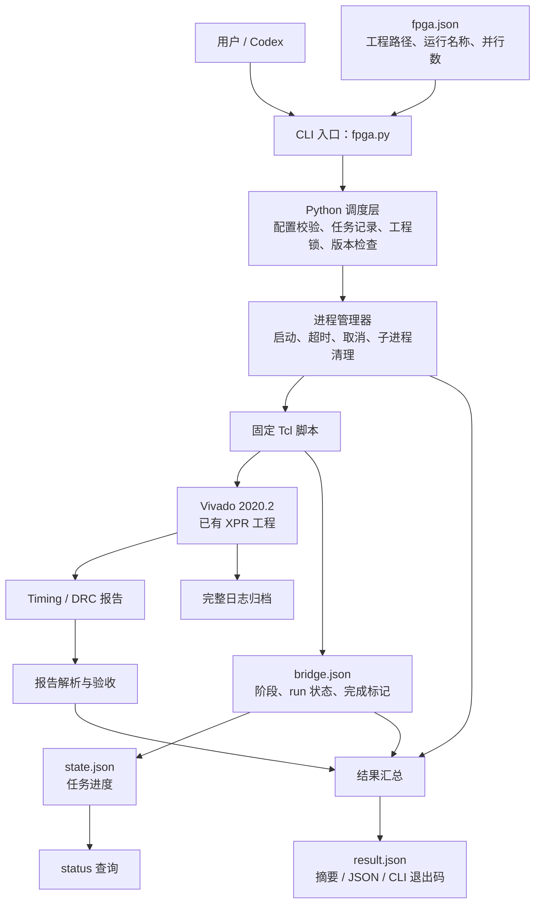

> 原便携包文档保留供参考。当前源码仓库的安装、目录和验证范围以 [README](../README.md) 与 [1.4.3 验证记录](VALIDATION-1.4.3.md) 为准；不包含原包 runtime/vendor 或历史硬件证据。

# FPGA Auto V1 架构讲解

本文对应当前已实现的 Windows / Vivado 2020.2 CLI。使用方式见 [README](../README.md)，
便携部署说明见 [使用说明](../README.md)。

核心分工是：**Python 管任务，Tcl 操作 Vivado，报告解析器判断设计是否达标，最后输出统一的 JSON 结果。**
工具围绕已有的 `.xpr` 工程工作，让用户和 Codex 能够稳定地执行、查询和判断一次工程操作。

## 1. 总体结构



系统有三条主要的数据通路：

- **操作通路：** 命令和配置经 Python 校验后，通过环境变量传给固定 Tcl，由 Tcl 调用 Vivado 工程命令。
- **进度通路：** Tcl 写入 `bridge.json`，Python 更新 `state.json`，`status` 读取任务记录。
- **结果通路：** Python 综合进程退出情况、Tcl 完成标记及报告解析结果，生成最终验收结论。

完整日志用于诊断。默认的进度与验收判断不依赖反复扫描完整日志。

## 2. 模块分工

| 模块 | 职责 |
| --- | --- |
| [fpga.py](../fpga.py) | 轻量入口，调用 CLI 主函数并返回退出码 |
| [cli.py](../fpga_auto/cli.py) | 解析八个子命令，组织操作流程，统一异常处理和输出 |
| [config.py](../fpga_auto/config.py) | 校验配置字段，按配置目录解析工程相对路径 |
| [vivado.py](../fpga_auto/vivado.py) | 发现可执行文件，确认版本，构造 Windows batch 调用 |
| [jobs.py](../fpga_auto/jobs.py) | 创建任务目录，原子保存 JSON，管理工程锁和历史任务查询 |
| [runner.py](../fpga_auto/runner.py) | 管理进程树、超时和取消，读取阶段信息，归档日志 |
| [discovery.py](../fpga_auto/discovery.py) | 只读工程盘点、清单别名、精确选择与历史过滤 |
| [background.py](../fpga_auto/background.py) | 独立 worker 提交、取消请求和持久化完成通知 |
| [monitor.py](../fpga_auto/monitor.py) / [monitor.html](../fpga_auto/monitor.html) | 独立本地只读监控、阶段进度和有界主/子日志尾部显示 |
| [common.tcl](../tcl/common.tcl) | 打开工程，检查 run 和 IP，执行综合、实现、报告生成 |
| [parser.py](../fpga_auto/parser.py) | 解析 Timing 与 DRC 报告，保留缺失值和未知状态 |
| [results.py](../fpga_auto/results.py) | 定义结果结构，汇总验收状态，映射 CLI 退出码 |

`tcl/` 下的 `check.tcl`、`synth.tcl`、`impl.tcl`、`build.tcl`、`timing.tcl`、`drc.tcl`
是固定入口，复用 `common.tcl` 中的操作。`build` 与独立命令共用同一套阶段实现和报告解析器。

配置只保存 `vivado_version`、`project`、`synth_run`、`impl_run`、`jobs` 五个字段。
工程路径相对于配置文件所在目录解析，Vivado 安装位置通过参数或环境发现，避免工程配置绑定某台电脑。

Vivado 发现顺序为 `--vivado → FPGA_VIVADO → XILINX_VIVADO → PATH → 常见安装目录`。
选定候选后必须验证为 2020.2；如果选中的是其他版本，直接返回版本错误。

## 3. 一次 build 如何执行

操作链路为：

```text
创建 Job → 校验配置 → 获取工程锁 → 验证 Vivado 版本
    → 启动 build.tcl → check → synth → impl → timing → drc
    → 确认完成并解析报告 → 释放工程锁 → 保存最终结果并返回
```

1. **先创建 Job。** 生成唯一任务 ID 和任务目录，再检查配置与环境。只要任务目录可写，
   后续的配置错误、版本错误和启动错误也能留下记录。
2. **锁定实际工程。** 根据规范化后的 `.xpr` 路径取得工程锁，再执行版本检查。
   不同配置文件指向同一工程时，也使用同一把锁。
3. **启动固定脚本。** Python 通过 `FPGA_PROJECT`、`FPGA_SYNTH`、`FPGA_IMPL`、`FPGA_JOBS`、
   `FPGA_JOB_DIR` 环境变量传入参数，固定 Tcl 脚本读取这些值。
4. **执行工程检查。** 检查工程能否打开、run 名称和类型、实现与综合的父子关系、源文件等。
   综合和实现还会检查已有 IP 产物是否就绪。
5. **执行四个阶段。** 综合重置并运行指定 synth run；实现使用当前综合结果，重置并运行指定 impl run；
   随后生成 Timing Summary 和 DRC 报告。默认停止于 `route_design`，或工程已启用的
   `phys_opt_design (Post-Route)`；普通 build 不请求 bit 生成。
6. **收集证据并验收。** 每个阶段通过桥接文件更新进度。进程退出后，必须同时满足进程退出码为 0、
   Tcl 发布有效完成标记，才能进入正常验收；Python 再解析报告并汇总结果。
7. **完成持久化。** 工程锁保护工程操作、子 run 日志归档及报告解析。释放锁后，
   Python 写入最终 `result.json` 和终态 `state.json`，然后输出摘要或 JSON。

`build` 的四个阶段在一个主要的 Vivado batch 进程中顺序执行；版本检查另有一个短进程。
Vivado 会通过 `launch_runs` 启动综合、实现子进程，并通过 `wait_on_run` 等待阶段结束。

`build --bit` 在上述报告验收通过后、释放同一工程锁之前，启动 `write_bit.tcl`。
独立 `bit` 则先用 `bit.tcl` 读取有效实现并生成新的 Timing/DRC 报告，然后执行同一写出阶段。
bit 阶段直接打开实现设计写独立产物，不重置综合/实现 run。两次 Vivado 调用使用同一个 Job 和总超时，
重置桥接完成标志，并在阶段切换处检查取消。最终产物要核对路径、非空内容和 SHA-256 后才记录 passed。
后台完成事件包含 bitstream 字段，只有全部请求阶段结束后才投递。详见 [bit 说明](BITSTREAM.md)。

独立的 `impl` 要求已有成功、未过期的综合结果和检查点，不会隐式补做综合。
独立的 `timing`、`drc` 读取已有、未过期的实现结果；`check`、`timing`、`drc` 以只读方式打开工程。

## 4. 执行完成与设计验收分开

`execution` 回答“请求的操作有没有成功执行完”，`acceptance` 回答“本次要求的设计验收是否通过”。
两者必须分别判断。例如，Vivado 已完成布线，但时序不收敛，结果的关键字段可以是：

```json
{
  "command": "build",
  "execution": "completed",
  "acceptance": "failed",
  "acceptance_scope": "build",
  "implementation": {
    "status": "passed",
    "run_status": "route_design Complete, Failed Timing!"
  },
  "timing": {
    "status": "failed"
  }
}
```

上面是字段摘录。它说明实现操作已经完成，但 Timing 验收失败，CLI 返回 `2`。
调用方应分析时序报告，而不是把这种情况归类为 Vivado 执行崩溃。

| 场景 | execution | acceptance | CLI 退出码 |
| --- | --- | --- | --- |
| 配置、环境或执行失败 | failed | unknown | 1 |
| 执行完成，必要验收全部通过 | completed | passed | 0 |
| 执行完成，必要验收有失败项 | completed | failed | 2 |
| 执行完成，必要验收数据无法确认 | completed | unknown | 3 |
| check / synth / impl 完成，未做完整验收 | completed | unknown | 0 |
| 用户取消 | failed，reason=cancelled | unknown | 130 |
| 设计验收通过，但 bit 生成失败 | failed | passed（保留已完成的设计验收） | 1 |

`acceptance_scope` 明确验收范围：`timing` 只评估时序，`drc` 只评估 DRC，
`build` 和 `bit` 要求综合、实现、Timing、DRC 均通过；`check`、`synth`、`impl` 为 `none`。
在所需项目中，只要有已确认的失败项，汇总就为 `failed`；全部通过才为 `passed`，其余为 `unknown`。

Timing 解析全局 Design Timing Summary，检查 setup、hold、pulse-width 指标与失败端点，
并要求 Vivado 的整体时序通过声明。缺失或无法解析的数据保留 `null` / `unknown`。
`failing_endpoints` 专指 setup/TNS 失败端点数，不把不同类型端点相加。

DRC 按违例数量统计各严重程度，并核对分类计数之和与报告总数。
V1 要求 Error 和 Critical Warning 均为零；Warning、Advisory、Info 保留在结果中但不阻止通过。

## 5. 任务目录与状态文件

```text
<配置目录>/.fpga/jobs/<job_id>/
├── request.json     本次请求和配置快照
├── state.json       任务状态、当前阶段、PID、时间
├── bridge.json      Tcl 提供的阶段、run 状态及完成信息
├── result.json      最终结果，执行中不提前生成
├── vivado.log       Vivado 主进程 stdout/stderr
├── version.log      版本检查输出（适用时）
└── reports/         Timing、DRC、利用率及子 run 日志
```

四个 JSON 的职责分别是：“要做什么”“任务现在怎样”“Vivado 做到了哪里”“最终结论是什么”。
`state.json` 供查询使用，`bridge.json` 是 Tcl 与 Python 的内部通信文件，
`result.json` 是操作完成后提供给用户和 Codex 的结果接口。

`status` 和 `logs` 直接读取任务记录，不启动 Vivado，也不需要有效的工程配置。
它们使用 `--config` 所在目录定位任务集合；默认优先选择仍在运行的任务，否则选择最近任务。
指定 `--job` 可以查看历史记录，`logs --follow` 才会持续输出日志内容。

`state.json` 中的进程返回码与 CLI 退出码含义不同：Vivado 可以正常退出并返回 `0`，
但报告显示时序失败时，CLI 仍返回 `2`。

## 6. 互斥、进程清理与异常恢复

- **工程锁：** 位于实际 `.xpr` 目录下的 `.fpga/project.lock`，依靠操作系统字节锁决定所有权。
  锁文件长期保留，文件存在不代表工程正在被占用。所有会打开工程的 CLI 操作共用此锁，
  包括报告读取；`status`、`logs` 不需要锁。该锁协调本 CLI，不管理手工启动的 Vivado GUI。
- **进程树管理：** Windows Job Object 管理本次 Vivado 及其子进程。超时或取消时清理整棵进程树；
  Python 被强制结束时，操作系统关闭句柄也会触发清理。磁盘上的任务 Job 是任务记录，
  Windows Job Object 是操作系统资源容器，两者不是同一个对象。
- **原子更新：** JSON 先写入临时文件，再替换目标文件，减少读到半份数据的风险。
  最终结果写入失败会返回 `job_write_failed`，不以成功结束；磁盘不可写时尽力保存失败信息，
  并通过标准输出保留失败结果。
- **所有者识别：** 结合 PID 与进程创建时间判断任务所有者是否存活，避免 PID 复用造成误判。
  遗留任务不会因为状态文件仍写着 running 就永久显示运行中，也不会被推断为成功。
- **诊断保留：** 释放工程锁前归档相关综合、实现子 run 日志，避免下一次 reset 覆盖失败证据。

后台 start 由独立 worker 持有进程树；前台提交器退出不取消构建。
worker 释放工程锁并保存最终结果之后，按明确任务 UUID 投递完成事件；一次操作为一个事件边界。
通知记录与编译结果分开，队列成功不代表模型已处理。取消请求由 worker 处理，不通过盲杀 PID 实现。
Codex 事件模式不轮询；前台额外状态检查遵从用户/工程约定，未约定时最少 900 秒。
CLI 内部进程等待、状态更新和超时处理独立进行。协议见 [阶段执行规则](CODEX-WORKFLOW.md)。

## 7. V1 边界与代码阅读顺序

V1 使用 Python 标准库和固定 Tcl，支持 Windows、Vivado 2020.2、已有 XPR 的 Project Mode。
工具不编辑 RTL/XDC，不自动升级或重新生成 IP，不改变器件、顶层、时钟约束和 strategy。
综合及实现沿用工程设置和钩子；独立 `write_bitstream` 使用实现中保存的属性，不执行 run 的 bitstream PRE/POST 钩子。
本地工作流修订包括只读发现、每作业后台 worker、可选 Codex 桌面完成通知、本地只读监控页和 bit 生成。
核心操作不包含仿真、MCP 服务、常驻调度服务、远程执行、数据库或多版本抽象；仿真仅用于独立回归脚本。
desktop.py 作为现有桌面 app-tools 命名管道的客户端，发送事件到原任务；短期子进程界定阻塞 I/O 的超时。
结果、发送确认、模型接收回执分别保存，通知错误不覆盖构建结果。不另开模型进程或轮询模型。

建议先读 [cli.py](../fpga_auto/cli.py) 中的 `execute`，了解一次调用的组织方式；
再读 [common.tcl](../tcl/common.tcl) 中的 `main` 和 `build`，了解工程操作顺序；
接着读 [results.py](../fpga_auto/results.py) 中的 `apply_acceptance`，了解结果汇总。
需要研究互斥和异常恢复时，再读 `jobs.py` 与 `runner.py`。
